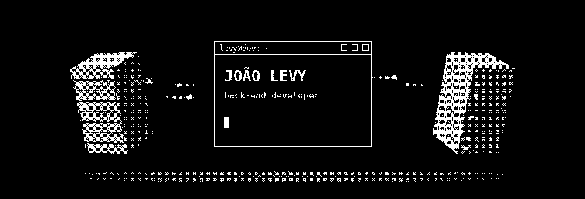

<!-- ================= BANNER ================= -->

  

  

<!-- ================= LINKS ================= -->

  
  
  
  

---

<h2 align="center">🚀 Sobre mim</h2>

<table>
<tr>
<td width="62%">

Desenvolvedor back-end focado em **Python e Java**, construindo APIs, bots e automações que resolvem problemas reais. Desde 2026 atendo clientes como freelancer, entregando sites, landing pages e bots, e coloco no ar projetos próprios com IA, como uma assistente de voz que roda 100% local e um bot de ofertas que funciona 24h na nuvem.

- 🎓 Cursando **Análise e Desenvolvimento de Sistemas** (UNIASSELVI, 2026 – 2028)
- 💼 Buscando minha primeira vaga remota de **back-end júnior** ou **suporte técnico**
- 🤖 Evoluindo a **Marin**, minha assistente de voz com IA local
- 📍 Teresina, PI · 🌎 Aberto a vagas remotas

> **In English:** Back-end developer (Python & Java) building APIs, bots and AI-powered automations. Freelancer since 2026, open to remote junior roles.

</td>
<td width="38%" align="center">
  
</td>
</tr>
</table>

---

<h2 align="center">💻 Tecnologias</h2>

   
  

---

<h2 align="center">🧩 Projetos</h2>

  
  
  
  
  

| Projeto | O que faz | Stack |
|---|---|---|
| 🎙️ **[Marin](https://github.com/levyespigue14-ux/marin)** | Assistente de voz estilo "Jarvis" para Windows. Entende a fala com Whisper, uma IA local (Ollama) decide qual função executar via *tool calling* e ela responde falando. Toca música, abre programas, cria lembretes, avisa e-mails de vagas e ajuda na prospecção de clientes. | Python · Whisper · Ollama · pywebview |
| 📈 **[Levylly Leads](https://github.com/levyespigue14-ux/levylly-leads)** | API de prospecção para quem vende sites a negócios locais. Dá nota de 0 a 100 para cada lead (avaliação no Google, popularidade, se tem site, WhatsApp e Instagram), monta a fila do dia, controla etapas do CRM e follow-ups automáticos e mede o funil com ranking de objeções. Importa planilha CSV. CI testando em SQLite e PostgreSQL. | Python · FastAPI · PostgreSQL · pytest · Docker |
| ☕ **[API de Leads](https://github.com/levyespigue14-ux/api-leads)** | API REST para gestão de leads de prospecção: CRUD com validação, funil de status, follow-up agendado automaticamente, filtros com paginação e erros padronizados. Testes de unidade e de ponta a ponta, CI no GitHub Actions e Docker Compose com PostgreSQL. | Java 21 · Spring Boot 3 · JPA · PostgreSQL · JUnit · Docker |
| 🤖 **[Shopee Deals Bot](https://github.com/levyespigue14-ux/shopee-deals-bot)** | Busca ofertas pela API de Afiliados da Shopee, filtra por desconto, nota e vendas e publica sozinho no Telegram com textos escritos por IA. Gera vídeos verticais para Reels/TikTok e roda 24h como serviço *systemd* numa VM Linux na Oracle Cloud. | Python · GraphQL · Telegram Bot API · Claude API · SQLite |
| 🎬 **[Robô de vídeos](https://github.com/levyespigue14-ux/robo-videos)** | Duas vezes por dia busca um produto em alta, escreve o roteiro com IA e monta sozinho um vídeo vertical com voz neural, música e legendas animadas. Entrega no Telegram com a legenda pronta para postar. | Python · Pillow · edge-tts · Claude API · cron |
| 🌐 **Sites para clientes** | Landing pages publicadas para negócios reais: [Demerval Fretes](https://demerval-fretes.netlify.app) e [AldeciFretes](https://aldecifretes.netlify.app). Modelos por nicho usados na prospecção: [energia solar](https://solar-aurora.netlify.app), [restaurante japonês](https://sumi-demo.netlify.app) e [açaiteria](https://igarape-acai.netlify.app). | HTML · CSS · JavaScript · Netlify |

<h3 align="center">🎥 Marin em ação</h3>

---

<h2 align="center">📊 Estatísticas</h2>

  
  

  

---

<h2 align="center">📈 Gráfico de atividade</h2>

  

  <picture>
    <source media="(prefers-color-scheme: dark)" srcset="https://raw.githubusercontent.com/levyespigue14-ux/levyespigue14-ux/output/github-contribution-grid-snake-dark.svg" />
    
  </picture>

  

